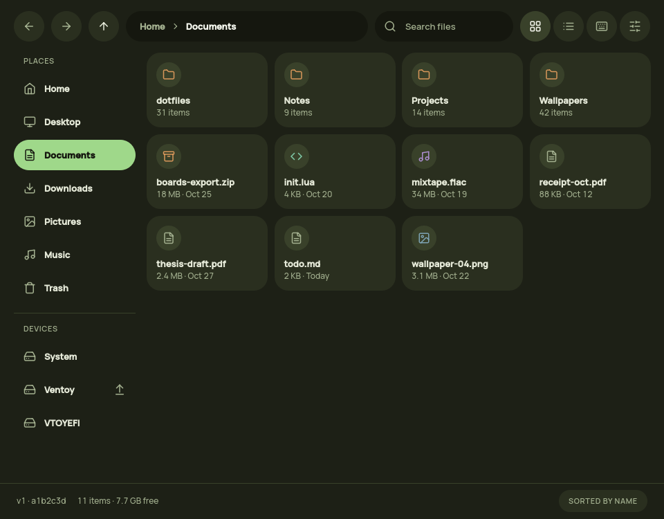

<div align="center">
  

  # Pistachio FM

  **A quiet place for your files.**

  A Qt file manager made for the Pistachio shell, with the soft surfaces and dark greens of Pistachio Noir.

  
  
  
  
  

  [Features](#features) · [Getting started](#getting-started) · [Keyboard shortcuts](#keyboard-shortcuts) · [Development](#development)
</div>

---

Pistachio FM is a local file manager built with QML and C++ on Qt 6. It is designed to sit alongside the Pistachio shell while handling the everyday work: browsing, organising, previewing and moving files.

<p align="center">
  
  <br>
  <sub>Grid view with sample files and version. Device names reflect the capture system.</sub>
</p>

## Features

<table>
<tr>
<td width="50%" valign="top">

**Make room to work**

- Grid and list views, tabs, and a split view with a resizable divider.
- Breadcrumbs, back/forward history, bookmarks and path completion.
- Reopen a closed tab, including its split folders and pane sizes.

</td>
<td width="50%" valign="top">

**Find and preview**

- Filter the current folder or search filenames recursively.
- Preview text, images and PDFs with <kbd>Space</kbd>.
- Image and PDF zoom, panning and PDF page navigation.

</td>
</tr>
<tr>
<td width="50%" valign="top">

**Work with files**

- Copy, cut, paste and drag between apps; stop a running transfer.
- Rename a selection with find-and-replace and a live preview.
- Undo recent operations, create ZIP archives and extract archives.

</td>
<td width="50%" valign="top">

**At home on Linux**

- Trash and restore, including per-drive trash locations.
- GTK-shared bookmarks and removable-drive mounting through udiskie.
- Open With and desktop-wide default application settings.

</td>
</tr>
</table>

Click the version in the lower-left corner for the commit, compiler, Qt, Meson and system information.

## Getting started

### Requirements

- **Linux** with Qt **6.9 or newer**, including Qt Quick and Qt Quick Controls.
- **Clang**, **Meson**, **Ninja**, a C++20 standard library and Python 3 to build.
- **libarchive** (`bsdtar`) for compression and extraction.
- **udiskie** and `lsblk` for removable-drive mounting; **xdg-utils** for default application settings.
- **Poppler** (`pdfinfo` and `pdftoppm`) for PDF previews. Text and image previews work without it.
- **Manrope** and **JetBrains Mono** for the intended typography.

On Arch Linux, the relevant package names include `qt6-base`, `qt6-declarative`, `clang`, `meson`, `ninja`, `libarchive`, `udiskie`, `xdg-utils` and `poppler`.

### Build and run

```sh
CC=clang CXX=clang++ meson setup build-meson --prefix="$HOME/.local"
meson compile -C build-meson

./build-meson/pistachio-fm                 # open Home
./build-meson/pistachio-fm ~/Downloads     # open a folder
```

Passing a file opens its parent folder and selects it. The Wayland app ID is `pistachio-fm`.

### Install

To configure, build and install to `~/.local` in one step:

```sh
./install.sh
```

Or, after configuring the build directory yourself:

```sh
meson install -C build-meson
```

The install includes the executable, desktop entry and hicolor icon. The desktop entry uses the configured installation path, so it also works with launchers whose `PATH` does not contain `~/.local/bin`.

## Keyboard shortcuts

Press <kbd>F1</kbd> or <kbd>?</kbd> in the app for the shortcuts card.

| Shortcut | Action |
|:--|:--|
| <kbd>Enter</kbd> / double-click | Open the selection |
| <kbd>Space</kbd> | Preview one file; press again to close |
| <kbd>Ctrl</kbd> + <kbd>F</kbd> | Filter by filename; use the search icon to include subfolders |
| <kbd>Ctrl</kbd> + <kbd>L</kbd> | Edit the path; <kbd>Tab</kbd> completes folder names |
| <kbd>Alt</kbd> + <kbd>←</kbd> / <kbd>→</kbd> | Go back / forward |
| <kbd>Backspace</kbd> / <kbd>Alt</kbd> + <kbd>↑</kbd> | Go up a folder |
| <kbd>Ctrl</kbd> + <kbd>1</kbd> / <kbd>2</kbd> | Grid / list view |
| <kbd>Ctrl</kbd> + <kbd>H</kbd> | Show or hide hidden files |
| <kbd>Ctrl</kbd> + <kbd>T</kbd> / <kbd>W</kbd> | Open / close a tab |
| <kbd>Ctrl</kbd> + <kbd>Shift</kbd> + <kbd>T</kbd> | Reopen a closed tab |
| <kbd>Ctrl</kbd> + <kbd>Tab</kbd> | Switch tabs |
| <kbd>F3</kbd> | Open or close split view |
| <kbd>Ctrl</kbd> + <kbd>C</kbd> / <kbd>X</kbd> / <kbd>V</kbd> | Copy / cut / paste |
| <kbd>Ctrl</kbd> + <kbd>Z</kbd> | Undo the most recent operation |
| <kbd>F2</kbd> | Rename; select multiple items for batch find-and-replace |
| <kbd>Alt</kbd> + <kbd>Enter</kbd> | Properties for the selection or current folder |
| <kbd>Ctrl</kbd> + <kbd>Shift</kbd> + <kbd>N</kbd> | New folder |
| <kbd>Ctrl</kbd> + <kbd>Alt</kbd> + <kbd>N</kbd> | New empty file |
| <kbd>Delete</kbd> / <kbd>Shift</kbd> + <kbd>Delete</kbd> | Move to trash / delete permanently |
| <kbd>Ctrl</kbd> + <kbd>D</kbd> | Bookmark the current folder |
| <kbd>Ctrl</kbd> + <kbd>,</kbd> | Default application settings |
| <kbd>F5</kbd> / <kbd>Ctrl</kbd> + <kbd>R</kbd> | Reload |

Drag files onto folders, sidebar places or breadcrumbs. On a drop, hold <kbd>Ctrl</kbd> to copy or <kbd>Shift</kbd> to move. In split view, drag the divider to adjust the panes.

## Good to know

- **Conflicts:** copies with an existing name keep both items using a numbered name. Replace, skip and folder-merge choices are not available yet.
- **Search:** recursive search matches filenames, not file contents; it does not follow directory symlinks. New matches outside watched result folders may need <kbd>F5</kbd>.
- **Preview:** text is limited to 128 KiB; images use Qt's installed image formats. PDFs are rendered one page at a time with Poppler. Media and office-document previews are not included.
- **Connections:** network shares can be browsed if mounted as local paths; there is no built-in SMB or SFTP connection dialog.
- **Sessions:** tabs are not restored after the application exits. Undo keeps up to ten recent operations during the session.

See [FEATURE-GAPS.md](FEATURE-GAPS.md) for a more detailed comparison and the work still to do.

## Development

```sh
# Backend tests
LC_ALL=en_US.UTF-8 QT_FORCE_STDERR_LOGGING=1 meson test -C build-meson --print-errorlogs

# Offscreen UI checks and screenshots
QT_QPA_PLATFORM=offscreen QT_FORCE_STDERR_LOGGING=1 ./build-meson/pfm-shots /tmp/pfm-shots
```

Use an installed `en_US.UTF-8` locale for the backend's natural-sort test. The screenshot runner creates a temporary home and reports individual checks. [TESTING.md](TESTING.md) contains the manual desktop checks.

| Path | Purpose |
|:--|:--|
| [`qml/`](qml/) | Interface, shared components, theme and icons |
| [`src/`](src/) | File operations, folder models, previews and desktop integration |
| [`tests/`](tests/) | Backend tests and the UI screenshot runner |
| [`design/pistachio-file-manager/`](design/pistachio-file-manager/) | Original design boards |
| [`meson.build`](meson.build) | Build and install configuration |

The previous CMake configuration is preserved in [`cmake/CMakeLists.txt.backup`](cmake/CMakeLists.txt.backup).

## License

Pistachio FM is licensed under the [GNU General Public License v3.0](LICENSE) (GPL-3.0-only).

---

<sub>This project was written with assistance from Claude and Codex.</sub>
